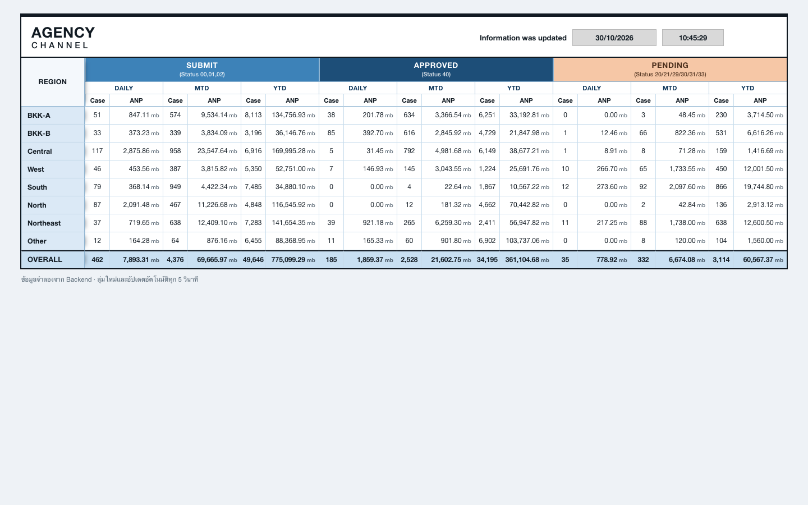
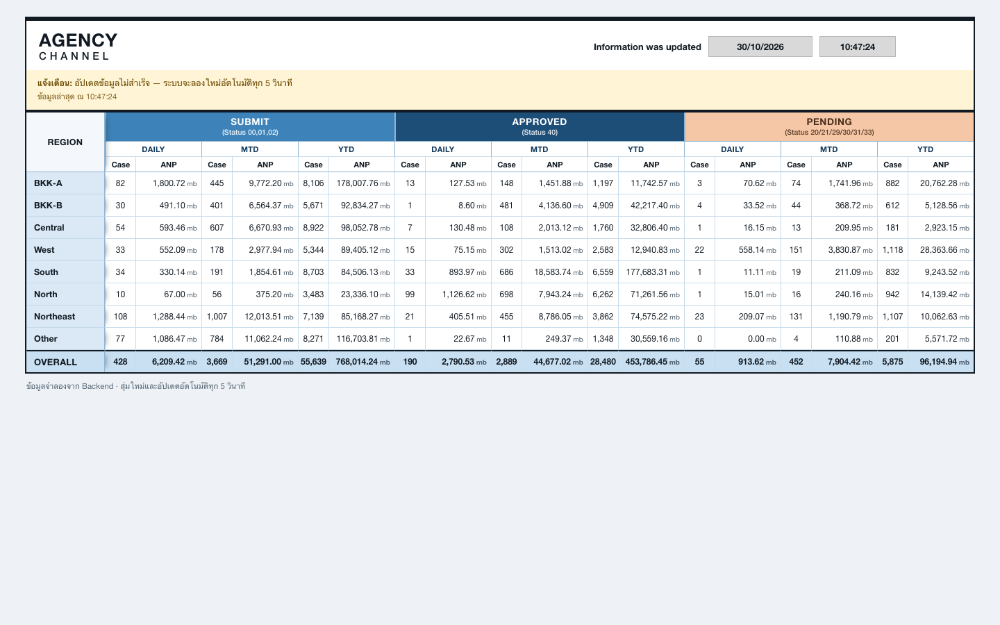

# Agency Dashboard — API collection & docs

## Bruno collection

โฟลเดอร์ `agency-docs-api/` เป็น Bruno collection ในรูปแบบ **OpenCollection YAML** (Bruno 4.x)
ใช้ทั้งยิง API ด้วยมือและรันชุดเทสต์สัญญา API

```
agency-docs-api/
├─ opencollection.yml          # collection: "Agency Dashboard API" + default environment = local
├─ environments/local.yml      # baseUrl = http://localhost:8080
├─ dashboard/get-dashboard.yml # GET /api/v1/dashboard + 7 assertions
├─ README.md
└─ screenshots/
```

> เดิม collection นี้อยู่ในรูปแบบ legacy `.bru` (Bruno v1) แล้วถูก migrate เป็น YAML
> เพื่อให้เปิด/แก้ไขได้ใน Bruno 4.x — ตัว request และ assertions ยังคงเดิมทุกข้อ

### ใช้งานผ่าน Bruno app

1. เปิด Bruno → **Open Collection** → เลือกโฟลเดอร์ `agency-docs-api`
2. เลือก environment **local**
3. กด **Send** ที่ request `dashboard / Get Dashboard`
4. ดูผล assertions ที่แท็บ **Tests**

### ใช้งานผ่าน CLI (ไม่ต้องเปิด app)

```bash
# ต้องรันที่ root ของ collection และ backend ต้องรันอยู่ (port 8080)
cd agency-docs-api
npx @usebruno/cli run              # ใช้ default environment = local (ตั้งไว้ใน opencollection.yml)
npx @usebruno/cli run --env local  # ระบุ environment เองก็ได้ ผลเหมือนกัน
```

### สิ่งที่ collection ตรวจ (`dashboard/get-dashboard.yml`)

| Test | สิ่งที่ยืนยัน |
|---|---|
| responds with 200 and JSON | endpoint พร้อมใช้งานและ content-type ถูกต้อง |
| is not cached | `Cache-Control: no-store` (กัน browser/CDN cache ข้อมูลเก่า) |
| Asia/Bangkok offset | `updatedAt` ลงท้าย `+07:00` และ parse เป็นวันที่ได้ |
| regions + OVERALL | 8 region ตามลำดับ BKK-A … Other และมีแถว OVERALL |
| cases / ANP | case เป็นจำนวนเต็ม ≥ 0, ANP ≥ 0 และมีทศนิยม 2 ตำแหน่ง |
| daily ≤ mtd ≤ ytd | ค่าที่เล็กกว่ารวมอยู่ในค่าที่ใหญ่กว่าเสมอ (ทั้ง Case และ ANP) |
| OVERALL = Σ region | ทุกกลุ่ม × ทุกช่วง ตรงกับผลรวมของ 8 region แบบ exact (คิดเป็นสตางค์/ร้อยละของ mb) |

> ต้องการดูว่า "สุ่มใหม่ทุกครั้ง" จริง ให้กด Send สองครั้งแล้วเทียบตัวเลข — ค่าจะเปลี่ยนทุกครั้ง (timestamp อาจเท่ากันได้ถ้าอยู่ในวินาทีเดียวกัน)

## ภาพหน้าจอ

| สถานะปกติ (อัปเดตทุก 5 วินาที) | เมื่อ API ล่ม: คงข้อมูลล่าสุด + แจ้งเตือน |
|---|---|
|  |  |

## Decision log (สรุปเหตุผลการออกแบบ)

- **คำนวณ OVERALL ที่ Backend** — เป็น single source of truth, ทุก client ได้ค่าเดียวกัน,
  กติกาปัดเศษอยู่ที่เดียว และเทสต์ invariant ฝั่ง server ได้ตรง
- **ANP เก็บเป็น integer hundredths แล้วแปลงเป็น `BigDecimal` scale 2** — ผลรวมจึงไม่มี
  floating-point drift และค่าที่แสดงบนจอรวมกันได้เท่ากับ OVERALL เป๊ะ
- **`daily ≤ mtd ≤ ytd`** — สุ่ม YTD ก่อน แล้วให้ MTD/Daily เป็นสัดส่วนของช่วงที่ใหญ่กว่า
  ทำให้ข้อมูลจำลองยังดูสมเหตุสมผลโดยไม่ต้องมี DB
- **Polling ด้วย `timer` + `exhaustMap`** — กัน request ซ้อนเมื่อ API ช้า และ `catchError`
  อยู่ภายใน inner observable ทำให้ stream หลักไม่ตาย เมื่อ API กลับมาจึงอัปเดตต่อเอง
- **`takeUntilDestroyed` + route-level provider** — service ถูกสร้างและถูกทำลายพร้อม route
  Dashboard ออกจากหน้าจึงหยุด poll ทันที (มี unit test ยืนยัน)
- **เก็บข้อมูลล่าสุดที่สำเร็จไว้** — error ไม่ล้าง `data`/`lastUpdated` แต่ขึ้น banner และ
  เคลียร์ banner อัตโนมัติเมื่อรอบถัดไปสำเร็จ
